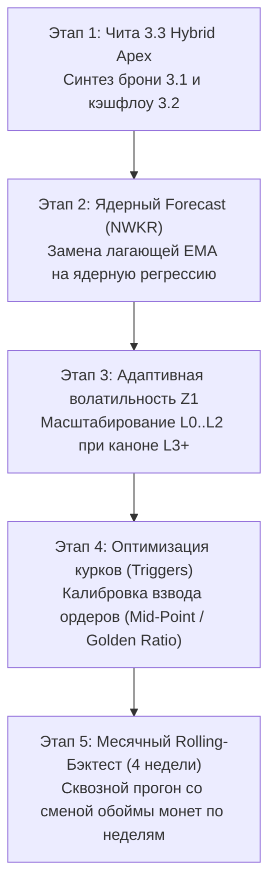

# 🗺️ Дорожная карта и План имплементации: Chita v3.3 Hybrid Apex, Ядерный Forecast и Месячный Rolling-Бэктест

---

## 🎯 1. Концептуальные принципы развития
1. **Неприкосновенность канона:** Текущие флагманы **Чита 3.1 [Боевая]** (`u16_chita_v31.json`) и **Чита 3.2 Turbo Scalp** (`u16_chita_v32.json`) остаются нетронутыми в своем оригинальном аутентичном виде.
2. **Эксперименты только через новые сущности:** Все новые модификации оформляются как независимые шаблоны (`u16_chita_v33.json`) и модули.
3. **Критерий истины — тики Binance Vision:** Каждая гипотеза проверяется только на реальных сделках `aggTrades` с учетом спреда, проскальзывания и комиссий.

---

## 📋 2. Детальный план работ (5 этапов)

---

### 🐆 Этап 1. Рождение Читы 3.3 (Chita v3.3 Hybrid Apex / Turbo-Shield)
* **Проблема:** Чита 3.1 имеет феноменальную броню (Max DD -$20), но на спокойном рынке собирает меньше кэша. Чита 3.2 генерирует огромный кэш (+140$ за 7 дней), но при резких контрдвижениях просадка доходит до -$75 из-за множителя объема 1.42x.
* **Решение в Чите 3.3:**
  1. **Ступенчатый адаптивный сайзинг:** При стагнации противоположной стороны (шаг >= 2) объем входа форсируется умеренно и плавно:
     * Шаг 2 стагнации ➔ множитель объема `1.15x`
     * Шаг 3 стагнации ➔ множитель объема `1.25x` (вместо резкого прыжка до 1.42x).
  2. **Сбалансированный Turbo-тейк:** Тейк-профит при стагнации сжимается до диапазона `0.95%..1.05%` (вместо 0.85% у 3.2 и 1.5%..1.8% у 3.1), что сохраняет высокую скорость тейков, но оставляет больше чистой маржи на сделку.
  3. **Сохранение брони:** L3 Мостик Змея (-13.5%), Half-Peel 50% и сжигание `mark_executed` остаются в строю.
* **Результат этапа:** Создание `CFG/universes/u16_chita_v33.json` и бенчмарк на 43.5 млн тиков.

---

### 🔬 Этап 2. Ядерная регрессия (Nadaraya-Watson Kernel Regression) вместо EMA
* **Проблема:** Экспоненциальные скользящие средние (EMA 10/30) имеют фазовый сдвиг (лаг). При резкой смене тренда бот еще несколько часов считает тренд восходящим, когда рынок уже валится.
* **Решение:**
  1. Разработка модуля `CORE/FORECAST/kernel_regression.py`.
  2. Использование непараметрической ядерной регрессии Надарая-Ватсона с адаптивным гауссовым ядром (bandwidth $h$).
  3. Оценка первой производной (мгновенный импульс) и второй производной (кривизна/затухание импульса).
  4. Когда кривизна меняет знак на вершине — алгоритм определяет затухание импульса **до** пересечения скользящих средних и предотвращает перегруз лонгов на хаях.
* **Результат этапа:** Подключение `forecast_engine: "nadaraya_watson"` в правило кулака Сильной руки.

---

### 🌊 Этап 3. Динамическая адаптация первой зоны сетки (L0..L2) к волатильности
* **Проблема:** Фиксированные отступы L1 (-3.5%) и L2 (-8.0%) одинаковы и в штиль, и в шторм. В штиль цена долго не достает до усреднения, а в шторм сразу сбивает первые колена.
* **Решение:**
  1. **Зона 1 (Скальп L0..L2):** Шаг масштабируется через волатильность Паркинсона (Parkinson High-Low Volatility) или Yang-Zhang:
     * Низкая волатильность: отступы сжимаются до -2.5% / -6.0% для частого кэшфлоу.
     * Высокая волатильность: отступы расширяются до -4.5% / -10.0%, оберегая депозит от импульсных сквизов.
  2. **Зона 2 и 3 (L3 Мостик Змея -13.5% и глубже):** **Незыблемый канон**, фиксированная глубокая броня.
* **Результат этапа:** Параметр `dynamic_zone1_volatility: true` в конфиге.

---

### 🎯 Этап 4. Оптимизация курков (Triggers)
* **Проблема:** Сейчас курок взводит лимитный ордер строго по факту касания определенного порога.
* **Решение:**
  1. Исследование геометрии взвода:
     * **Mid-Point Trigger:** курок взводится ровно на 50% расстояния между текущей ступенью и полом следующей.
     * **Golden Ratio Trigger (0.618):** взвод по золотому сечению.
  2. Ранний взвод позволяет разместить ордер в стакан лимитом (Maker fee 0.02% вместо Taker 0.05%), экономя до 60% на комиссиях биржи.
* **Результат этапа:** Сравнительный бэктест геометрии курков.

---

### 🗓️ Этап 5. Месячный Rolling-Forward стресс-тест со сменой обоймы монет
* **Концепция:** В боевых условиях состав монет Альфы обновляется каждую неделю. Месячный тест должен отражать именно эту механику:
  * **Неделя 1 (28 дней назад ➔ 21 день назад):** Обойма Альфы #1 ➔ скачивание тиков ➔ прогон 7 дней ➔ фиксация эквити и открытых позиций.
  * **Неделя 2 (21 день назад ➔ 14 дней назад):** Обновление обоймы монет на Альфу #2 ➔ прогон 7 дней ➔ фиксация.
  * **Неделя 3 (14 дней назад ➔ 7 дней назад):** Обойма #3 ➔ прогон 7 дней ➔ фиксация.
  * **Неделя 4 (7 дней назад ➔ текущий момент):** Обойма #4 (с пампом RLC) ➔ финальный прогон.
* **Результат этапа:** Полный институциональный месячный отчет со сквозной кривой доходности.
