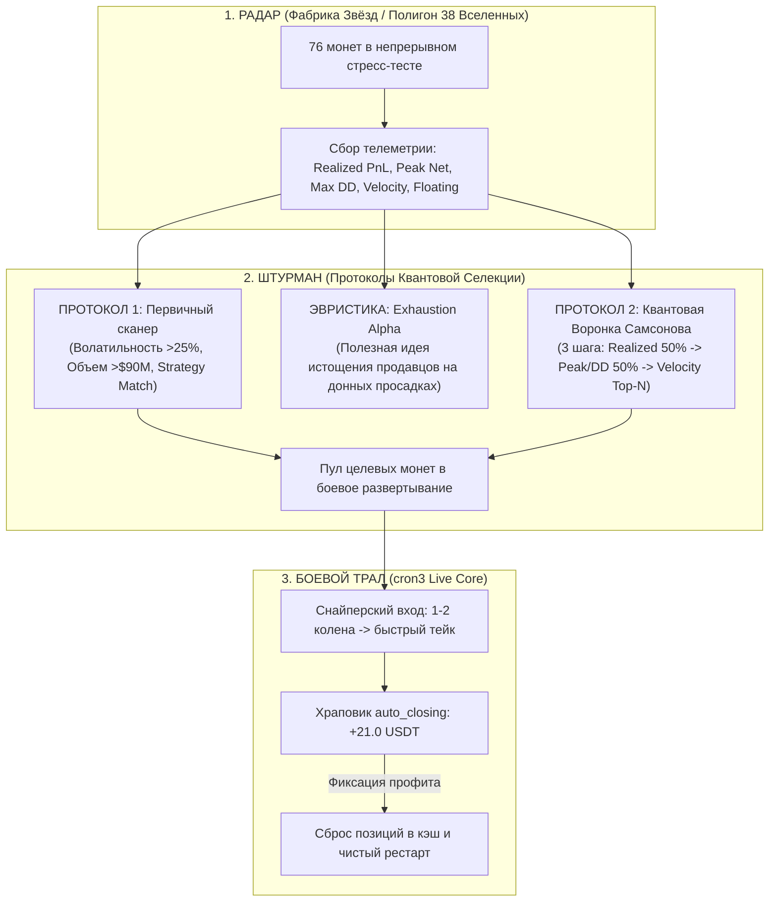
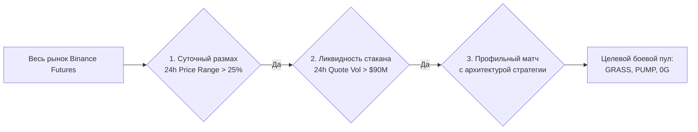
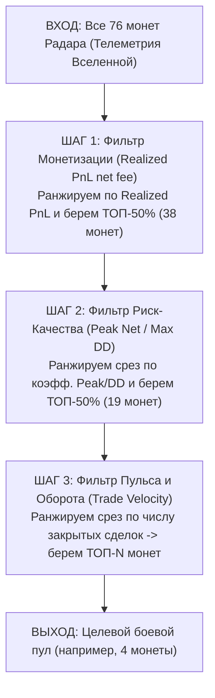

# ============================================================
# FILE: COIN_SELECTION_THEORIES.md
# ROLE: Quant research manifest & selection protocols (Radar -> Navigator -> Combat)
# ============================================================

# Квантовые Протоколы Селекции Монет: Мост «Фабрика Звёзд ➔ Боевой Бот»
**Автор концепций и алгоритмов**: Главный Тим Лид Самсонов Николай  
**Роль документа**: Официальный протокол селекции активов и квантовый регламент фильтрации между исследовательской Фабрикой Звёзд (38 Вселенных на 76 монетах) и боевым торговым ядром (`cron3`).  
**Статус**: **УТВЕРЖДЕННЫЙ КВАНТОВЫЙ РЕГЛАМЕНТ (Approved Quant Protocols & Heuristics)**

---

## 1. Архитектурная триада экосистемы

---

## 2. ПРОТОКОЛ 1: Первичный сканер волатильности и ликвидности (Первый механизм отбора)
> **Статус**: **ПЕРВЫЙ БАЗОВЫЙ МЕХАНИЗМ В ПРОТОКОЛЕ ПОИСКА** (Зафиксирован по первоначальному боевому пулу `GRASSUSDT`, `PUMPUSDT`, `0GUSDT`).

Первый список монет для старта боевого полигона отбирался по жестким квантовым фильтрам рыночной активности Binance Futures:

### 2.1. Критерии отбора первого пула:
1. **Экстремальный суточный размах волатильности (24h Price Range $\ge$ 25%)**:
   - Размах рассчитывается как: $\text{Range}_{24h} = \frac{\text{High}_{24h} - \text{Low}_{24h}}{\text{Low}_{24h}} \times 100\%$.
   - Монета обязана обладать мощной внутридневной амплитудой, чтобы сетка DCA совершала быстрые обороты на первых 1–3 коленах без застревания во флэте.
   - **Фактические показатели первого пула**:
     - `0GUSDT`: **45.4%** суточного размаха (абсолютный лидер амплитуды).
     - `GRASSUSDT`: **35.4%** суточного размаха (сильный трендовый маятник).
     - `PUMPUSDT`: **26.4%** суточного размаха (гиперактивный микро-скальпинг).
2. **Институциональная ликвидность фьючерсного стакана (24h Quote Volume $\ge$ $90M)**:
   - Объем торгов в котируемой валюте гарантирует минимальный спред, отсутствие проскальзываний при исполнении рыночных и лимитных ордеров, а также постоянный приток маркет-тейкеров.
   - **Фактические показатели первого пула**:
     - `PUMPUSDT`: **~$539,000,000** (сверхликвидность, мгновенное сведение).
     - `0GUSDT`: **~$217,000,000** (высочайшая плотность стакана).
     - `GRASSUSDT`: **~$92,000,000** (устойчивый институциональный объем).
3. **Профильное соответствие стратегии (Strategy-Coin Match)**:
   - Монеты не назначаются вслепую, а распределяются по архитектурным профилям:
     - `0GUSDT` $\to$ стратегия **Mean Reversion / Knife Blocker** (`u9_omni_zenith_apex`): блокиратор ножей и адаптивный шаг сетки гасят гиперамплитуду.
     - `PUMPUSDT` $\to$ стратегия **Flat Scalper** (`u0_075`): узкий плоский тейк-профит забирает микроколебания гигантской ликвидности.
     - `GRASSUSDT` $\to$ стратегия **Classic SuperGrid** (`u0_fat_swing123`): широкий шаг сетки собирает длинные раскатистые волны.

---

## 3. ЭВРИСТИЧЕСКАЯ ИДЕЯ: «Exhaustion Alpha» (Поиск монет с истощением продавцов)
> **Статус**: **ПОЛЕЗНАЯ ЭВРИСТИЧЕСКАЯ ИДЕЯ / КАЧЕСТВЕННАЯ ГИПОТЕЗА** (Вспомогательный качественный фильтр фазы рынка, не заменяющий алгоритмическую воронку).

### 3.1. Суть идеи:
Вместо догматического отбора «самых зеленых» лидеров дня, полезно оценивать **фазу рыночного стресса**:
- Если актив находится на пике пампа, входить в него сеткой опасно: велик риск поймать вершину рынка и получить тяжелую коррекцию на 7–9 колен.
- Если актив уже пережил глубокий сброс (Sell-off), каскад маржинальных ликвидаций смыл слабые руки, и на исследовательском полигоне Радара образовалась донная просадка при затухании скорости падения — в стакане возникает **истощение продавцов (Seller Exhaustion)**.
- **Эффект входа без багажа (Zero Baggage Entry)**: Боевой бот, заходя в такую стабилизировавшуюся на дне монету со свежей маржой, берет 1–2 колена на донном отскоке и фиксирует быструю чистую прибыль.

### 3.2. Практическая роль эвристики:
Идея истощения продавцов используется как **предохранительный фильтр тайминга**:
- Не заходить в перегретые монеты на хаях импульса.
- Проверять по Радару, чтобы монета не находилась в процессе активного свободного падения («падающий нож»), а сформировала донную консолидацию.

---

## 4. ПРОТОКОЛ 2: Алгоритм «Квантовая Воронка Самсонова» (Samsonov Funnel)
> **Статус**: **ОСНОВНОЙ АЛГОРИТМИЧЕСКИЙ МЕХАНИЗМ РАНЖИРОВАНИЯ И СЕЛЕКЦИИ**  
> Устраняет недостатки непрерывных мультипликативных формул за счет **строгой 3-ступенчатой последовательной воронки фильтрации**.

### 4.1. Архитектура 3-ступенчатой Воронки Самсонова

### 4.2. Пошаговый алгоритм:
1. **Шаг 1 (Фильтр Монетизации — Realized PnL)**:
   - Все 76 монет ранжируются по показателю чистой зафиксированной прибыли: $\text{Realized PnL}_{\text{net}}$ (за вычетом комиссий).
   - Берется верхний срез **ТОП-50%** (38 монет).
   - **Физический смысл**: Отсекаются неликвидные, «спящие» и неспособные генерировать денежный поток активы.
2. **Шаг 2 (Фильтр Асимметрии Риска — Peak Net / Max DD)**:
   - Оставшиеся 38 монет ранжируются по коэффициенту устойчивости:
     $$\text{Resilience} = \frac{\max(\text{Peak Net}, 0)}{\max(|\text{Max DD}|, 0.5)}$$
   - Берется верхний срез **ТОП-50%** (19 монет).
   - **Физический смысл**: Безжалостно отсекаются «мины замедленного действия» — монеты, накрутившие прибыль ценой колоссальных просадок (например, `MOVR` с просадкой $369, `0G` с просадкой $198, `GRASS` с просадкой $195). В пуле остаются только активы с чистым профилем риска.
3. **Шаг 3 (Фильтр Торговой Скорости — Trade Velocity)**:
   - Оставшиеся 19 монет ранжируются по количеству закрытых торговых циклов ($\text{Trades}$).
   - Отбирается целевое число монет $\mathbf{N}$ (например, ТОП-4).
   - **Физический смысл**: Из пула высокодоходных и безопасных монет отбираются самые динамичные («пульсирующие»), обеспечивающие максимальную частоту оборота депозита.

---

## 5. Фактические результаты работы алгоритма на Радаре

### 5.1. Вселенная `u0_fat_swing123` (Classic SuperGrid DCA)
* Входной пул: **76 монет**.
* Шаг 1 (Realized PnL): отобрано 38 монет (диапазон $+13.25\$$ .. $+72.78\$$).
* Шаг 2 (Peak/DD): отобрано 19 монет (диапазон коэффициента $0.59$ .. $4.60$).
* **Шаг 3: Итоговый боевой ТОП-4**:

| Ранг | Символ | Сделок (Velocity) | Realized PnL | Peak Net | Max DD | Peak / Max DD | Net Profit | Floating PnL |
| :-: | :--- | :-: | :-: | :-: | :-: | :-: | :-: | :-: |
| **#1** | **ZROUSDT** | **23** | **+61.02 $** | +41.93 $ | 60.56 $ | 0.69 | +21.56 $ | -39.46 $ |
| **#2** | **JUPUSDT** | **21** | **+34.06 $** | +29.69 $ | **6.45 $** | **4.60** | **+29.37 $** | **-4.69 $** |
| **#3** | **PYTHUSDT**| **17** | **+28.59 $** | +25.72 $ | **7.51 $** | **3.42** | **+25.72 $** | **-2.87 $** |
| **#4** | **XPLUSDT** | **16** | **+24.31 $** | +16.47 $ | 12.92 $ | 1.27 | +15.91 $ | -8.40 $ |
| *#5* | *ARXUSDT* | *15* | *+35.42 $* | *+23.50 $* | *40.16 $* | *0.59* | *+22.24 $* | *-13.18 $* |

---

### 5.2. Вселенная `u6_symbiosis_gamma_fortress35` (Symbiosis Gamma Fortress 3.5%)
* Входной пул: **76 монет**.
* Шаг 1 (Realized PnL): отобрано 38 монет (диапазон $+9.91\$$ .. $+47.53\$$).
* Шаг 2 (Peak/DD): отобрано 19 монет (диапазон коэффициента $0.61$ .. $4.79$).
* **Шаг 3: Итоговый боевой ТОП-4**:

| Ранг | Символ | Сделок (Velocity) | Realized PnL | Peak Net | Max DD | Peak / Max DD | Net Profit | Floating PnL |
| :-: | :--- | :-: | :-: | :-: | :-: | :-: | :-: | :-: |
| **#1** | **ARXUSDT** | **34** | **+37.87 $** | +34.73 $ | 35.64 $ | 0.97 | +29.53 $ | -8.33 $ |
| **#2** | **SYRUPUSDT**| **25** | **+22.58 $** | +21.71 $ | 31.63 $ | 0.69 | +14.47 $ | -8.11 $ |
| **#3** | **WLDUSDT** | **16** | **+19.04 $** | +18.56 $ | 18.22 $ | 1.02 | +17.88 $ | -1.16 $ |
| **#4** | **JUPUSDT** | **14** | **+23.27 $** | +20.40 $ | **4.31 $** | **4.73** | **+20.03 $** | **-3.24 $** |
| *#12*| *PYTHUSDT* | *8* | *+13.75 $* | *+12.60 $* | **2.63 $** | **4.79** | *+12.47 $* | *-1.28 $* |

---

## 6. Глубокий анализ результатов в свете аналитики Радара

### 6.1. Феномен квантовой устойчивости: `JUPUSDT` и `PYTHUSDT`
1. **Аномальное качество риска**:
   - Во **всех** исследованных вселенных (`u0`, `u6`) монеты `JUP` и `PYTH` демонстрируют рекордный коэффициент Peak/DD: **4.60 .. 4.73** для JUP и **3.42 .. 4.79** для PYTH.
   - Историческая максимальная просадка на дистанции сотен часов составила всего **$4.31 – $6.45** (JUP) и **$2.63 – $7.51** (PYTH).
   - Это означает, что монеты генерируют стабильный денежный поток без опасных провисаний сетки, закрываясь преимущественно на 1–2 коленах.
2. **Идеальное попадание в боевой бот**:
   - Назначение связки `JUPUSDT` + `PYTHUSDT` в боевую стратегию `u6_symbiosis_gamma_fortress35` полностью подтверждено математикой Воронки Самсонова.

### 6.2. Скоростные локомотивы монетизации: `ZROUSDT` и `ARXUSDT`
1. **`ZROUSDT` (Лидер скорости u0)**:
   - В классической сетке `u0` ZRO показал рекордную монетизацию: 23 сделки и **+$61.02 Realized PnL**.
   - При этом просадка достигала $60.56, что удерживает его коэффициент Peak/DD на уровне 0.69. Это мощный, но требующий маржинального запаса актив.
2. **`ARXUSDT` (Лидер скорости u6)**:
   - В крепостной гамма-стратегии `u6` ARX стал абсолютным чемпионом по числу оборотов: **34 закрытые сделки** и **+$37.87 Realized PnL** при умеренной просадке ($35.64).
   - Он представляет собой первоклассного кандидата для расширения портфеля `u6`.

### 6.3. Эффект отсечения ловушек ликвидности
- На Шаге 2 Воронка Самсонова автоматически отфильтровала такие активы, как `MOVR`, `0G`, `GRASS`, `PUMP`.
- Хотя они имеют колоссальный валовый оборот, их просадки на полигоне составляли от $75 до $369, что создавало неприемлемый риск для депозита $164 USDT.
- Алгоритм Самсонова оставил на выходе исключительно сбалансированные активы с положительным математическим ожиданием.
