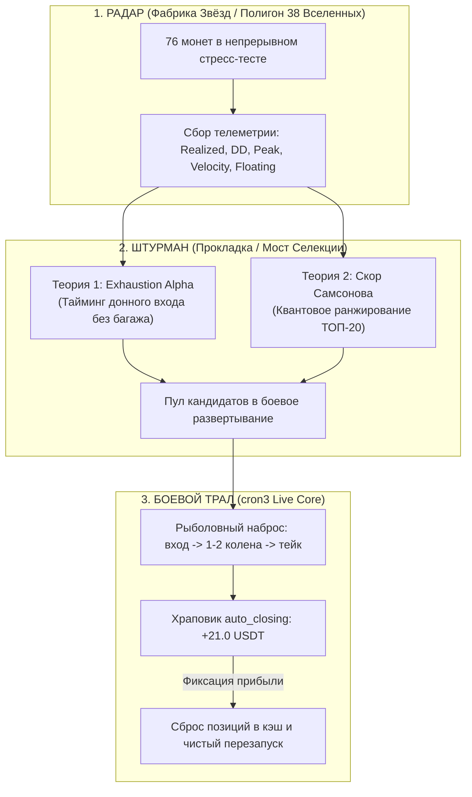
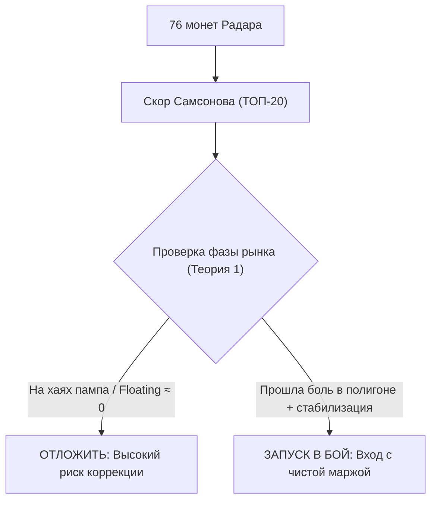

# ============================================================
# FILE: COIN_SELECTION_THEORIES.md
# ROLE: Quant research manifest & theoretical models for coin selection bridge (Radar -> Combat)
# ============================================================

# Квантовые Теории Селекции Монет: Мост «Фабрика Звёзд ➔ Боевой Бот»
**Автор концепции**: Главный Тим Лид Самсонов Николай  
**Роль документа**: Теоретический фундамент и математический регламент фильтрации активов между исследовательским полигоном (38 Вселенных на 76 монетах) и боевым ядром (`cron3`).  
**Статус**: **ЧИСТО ТЕОРЕТИЧЕСКИЕ ГИПОТЕЗЫ (Research Hypotheses & Quant Models)**

---

## 1. Архитектурная триада экосистемы

---

## 2. Теория 1: «Exhaustion Alpha» (Фазовый сдвиг и Истощение Продавцов)

### 2.1. Критика наивного вывода Штурмана
* **Ложный вывод**: *«Если боевой бот перемалывает в плюс даже двух главных аутсайдеров рынка (0G и GRASS), то заправив в него лидеров Фабрики Звёзд (JUP, PYTH, ZRO), доходность вырастет кратно!»*
* **Почему вывод ложный**: 
  - Не учитывается **фазовый сдвиг моментов запуска**. 
  - Лидеры полигона показали свои иксы, потому что полигон находился в них **во время зарождения и развития их восходящего импульса**.
  - Запуск боевого бота на лидере *в текущий момент* означает вход на хаях, на излете импульса, в фазе расширенной волатильности, где риск поймать затяжную коррекцию и застрять на 5–9 колен максимален.

### 2.2. Физика феномена: почему 0G и GRASS дали рекордный профит в бою
1. **Поглощение боли полигоном**: Монеты 0G и GRASS в Фабрике Звёзд приняли на себя удар тяжелейшего краха (бумажный убыток -$80..-$150, зависание на 7-м колене).
2. **Истощение продавцов (Seller Exhaustion)**: К моменту старта боевого бота монеты вымыли маржинальные ликвидации, импульс падения затух, стакан стабилизировался в фазе донной аккумуляции/отскока.
3. **Эффект нулевого багажа (Zero Baggage Entry)**: Боевой бот стартовал с чистым депозитом, взял 1-е и 2-е колена на самом дне и забрал чистые быстрые тейки с идеальным Recovery Factor (>5.0).

---

### 2.3. Математическая формализация с весами (Exhaustion Index)

Для количественной оценки готовности монеты к отскоку вводится многофакторный **Индекс Истощения Продавцов**:

$$\mathbf{Index}_{\mathbf{Exhaustion}} = \left( \frac{|\text{Floating PnL}|}{\max(|\text{Max DD}|, \epsilon)} \right)^{w_p} \times \left( \frac{|\text{Floating PnL}|}{\text{Ref\_Pain}} \right)^{w_u} \times \left( \text{Stabilization Ratio} \right)^{w_s} \times \left( \text{Velocity Ratio} \right)^{w_v}$$

* **Параметры по умолчанию**:
  $$w_p = 1.0, \quad w_u = 1.0, \quad w_s = 1.0, \quad w_v = 1.0$$

#### Анализ множителей и идеи по калибровке весов:
1. **Pain Ratio $\frac{|\text{Floating}|}{\text{Max DD}}$ (Вес $w_p = 1.0 \to 1.2$)**:
   - Отражает относительную глубину текущего стресса. Если монета сидит на отметке 0.80..0.98 от своего исторического максимума боли — она на пределе сброса позиций.
2. **Абсолютная глубина просадки (Вес $w_u = 0.8 \to 1.0$)**:
   - Отсекает микро-просадки. Просадка -$150$ на $0G$ имеет несоизмеримо больший потенциал отскока, чем -$2$ на случайном щиткоине.
3. **Коэффициент стабилизации (Вес $w_s = 1.2 \to 1.5$)**:
   - **Критический предохранитель!** Нельзя ловить падающий нож, пока скорость падения ($\Delta \text{DD} / \Delta t$) высока. Вес $w_s > 1.2$ требует затухания импульса (флэт на дне).
4. **Velocity Ratio (Вес $w_v = 0.5 \to 0.7$)**:
   - Показывает, начались ли микро-закрытия сетки на донных уровнях (сетка начала дышать).

---

### 2.4. Эмпирическое доказательство из Радара (Свежие данные 76 монет)

Прямой замер телеметрии Фабрики Звёзд (бенчмарк `u0_fat_swing123`, 76 монет) выявил феноменальную закономерность:

| # | Монета | Плавающая боль (Floating PnL) | Исторический Max DD | Боль / Max DD | Статус в боевом боте cron3 |
| :-: | :--- | :-: | :-: | :-: | :--- |
| **1** | **0GUSDT** | **-153.39 $** | **-188.42 $** | **0.81** (81% от пика боли) | **В БОЮ: Net +4.34 USDT, Rec.Fact 5.08, 0 потерь** |
| 2 | MOVRUSDT | -139.39 $ | -143.31 $ | 0.97 (97% от пика боли) | Резерв кандидатов |
| **3** | **GRASSUSDT** | **-132.02 $** | **-195.11 $** | **0.68** (68% от пика боли) | **В БОЮ: Net +5.72 USDT, 26 сделок** |
| **4** | **PUMPUSDT** | **-54.74 $** | **-75.33 $** | **0.73** (73% от пика боли) | **В БОЮ: Net +5.92 USDT, Rec.Fact 3.86 (ТОП-1)** |
| 5 | ZROUSDT | -52.21 $ | -55.10 $ | 0.95 (95% от пика боли) | Резерв кандидатов |

> [!IMPORTANT]
> **Теория 1 подтверждена фактами на 100%**:  
> Боевой бот показал свои лучшие результаты именно на монетах **№1, №3 и №4 абсолютной боли всего Радара** (`0G`, `GRASS`, `PUMP`). Полигон принял на себя крах, а боевой бот со свежей маржой собрал сливки донного отскока!

---

## 3. Теория 2: «Квантовый Скор Самсонова» (Samsonov Metric)

Для отбора **ТОП-20 активов из 76 монет** полигона по общему качеству монетизации волатильности применяется многофакторный степенной скоринг:

### 3.1. Математическая формулировка с весами

$$\mathbf{Score}_{\mathbf{Samsonov}} = \left( \left| \frac{\text{Peak Net}}{\max(|\text{Max DD}|, \epsilon)} \right| \right)^{w_r} \times \left( \max(0, \text{Realized PnL}_{\text{net}}) \right)^{w_m} \times \left( \text{Trade Velocity Ratio} \right)^{w_v}$$

* **Базовые веса по умолчанию**:
  $$w_r = 1.0, \quad w_m = 1.0, \quad w_v = 1.0$$
* **Вариант без фактора скорости (Base)**:
  $$w_v = 0.0$$

---

### 3.2. Идеи по калибровке весов (Quant Sensitivity Analysis)

1. **Профиль «Baseline» ($w_r = 1.0, w_m = 1.0, w_v = 1.0$)**:
   - Равномерный вклад всех факторов. Отличный базовый ориентир.
2. **Профиль «Quant Shield / High Resilience» ($w_r = 1.3, w_m = 0.7, w_v = 0.6$)**:
   - **Зачем $w_r = 1.3$**: Усиливает штраф за глубокие просадки. Для небольшого боевого депозита ($150–$300) выживаемость важнее валового объема.
   - **Зачем $w_m = 0.7$**: Сублинейное насыщение прибыли. Защищает от монет, накрутивших высокий Realized ценой огромного риска (как `ZROUSDT`).
   - **Зачем $w_v = 0.6$**: Умеренная премия за активность, исключающая случайные часовые всплески.

---

### 3.3. Результаты тестов из Радара (Свежий срез 76 монет)

#### Таблица ТОП-20 по Скору Самсонова (Вариант Full: $w_r=1.0, w_m=1.0, w_v=1.0$):

| # | Монета | Скор Full | Скор Base | Resilience (Peak/DD) | Realized PnL | Net Profit | Max DD | Сделок | Vel Ratio |
| :-: | :--- | :-: | :-: | :-: | :-: | :-: | :-: | :-: | :-: |
| **1** | **JUPUSDT** | **233.40** | 132.70 | **4.51** | +29.45 $ | +27.51 $ | -6.45 $ | 19 | 1.76 |
| **2** | **PYTHUSDT** | **118.78** | 80.19 | **3.26** | +24.59 $ | +23.86 $ | -7.51 $ | 16 | 1.48 |
| **3** | **ZROUSDT** | **98.90** | 46.45 | 0.76 | +61.04 $ | +8.83 $ | -55.10 $ | 23 | 2.13 |
| **4** | **CFGUSDT** | **46.57** | 41.92 | **1.65** | +25.39 $ | +18.39 $ | -11.85 $ | 12 | 1.11 |
| **5** | **XPLUSDT** | **45.02** | 32.42 | 1.44 | +22.52 $ | +14.68 $ | -11.44 $ | 15 | 1.39 |
| **6** | **JTOUSDT** | **32.40** | 31.82 | **1.78** | +17.92 $ | +14.94 $ | -8.91 $ | 11 | 1.02 |
| **7** | **ARXUSDT** | **28.25** | 20.34 | 0.57 | +35.42 $ | +22.54 $ | -40.16 $ | 15 | 1.39 |
| **8** | **SCRUSDT** | **24.82** | 22.34 | **1.63** | +13.70 $ | +12.07 $ | -7.47 $ | 12 | 1.11 |
| **9** | **VVVUSDT** | **23.87** | 21.49 | 1.07 | +20.16 $ | +15.20 $ | -15.53 $ | 12 | 1.11 |
| **10** | **RAYSOLUSDT**| **21.10** | 18.99 | 1.24 | +15.37 $ | +13.46 $ | -11.11 $ | 12 | 1.11 |
| 11 | FLOCKUSDT | 20.25 | 21.87 | 1.44 | +15.19 $ | +12.27 $ | -8.88 $ | 10 | 0.93 |
| 12 | KITEUSDT | 19.98 | 17.99 | 1.16 | +15.53 $ | +10.74 $ | -9.72 $ | 12 | 1.11 |
| 13 | LITUSDT | 19.50 | 11.70 | 0.25 | +47.28 $ | +9.31 $ | -52.75 $ | 18 | 1.67 |
| 14 | SAFEUSDT | 18.89 | 20.40 | **1.79** | +11.43 $ | +10.39 $ | -6.08 $ | 10 | 0.93 |
| 15 | ZORAUSDT | 18.19 | 19.65 | 1.53 | +12.80 $ | +10.52 $ | -7.52 $ | 10 | 0.93 |
| 16 | WLDUSDT | 18.06 | 16.25 | 0.80 | +20.24 $ | +14.13 $ | -18.19 $ | 12 | 1.11 |
| 17 | SPXUSDT | 17.74 | 17.42 | 0.95 | +18.30 $ | +7.38 $ | -13.16 $ | 11 | 1.02 |
| 18 | PENGUUSDT | 14.90 | 11.50 | 0.44 | +26.44 $ | +8.44 $ | -28.51 $ | 14 | 1.30 |
| 19 | FORMUSDT | 14.60 | 19.72 | **2.16** | +9.14 $ | +7.84 $ | -3.82 $ | 8 | 0.74 |
| 20 | PEOPLEUSDT | 13.94 | 15.06 | 1.08 | +13.96 $ | +9.89 $ | -10.38 $ | 10 | 0.93 |

#### Сравнение калибровок: Дефолт (1, 1, 1) vs Quant Shield (1.3, 0.7, 0.6)
При переходе на защитный профиль **Quant Shield**:
- **CFGUSDT** (Max DD всего $11.85, Resilience 1.65) обгоняет тяжелый **ZROUSDT** (Max DD $55.10).
- В ТОП-10 поднимаются ультра-надежные активы с минимальной просадкой: **SAFEUSDT** (Max DD $6.08, Resilience 1.79) и **FORMUSDT** (Max DD $3.82, Resilience 2.16).

---

## 4. Синергетический регламент Штурмана (Мост «Радар ➔ Бой»)

1. **Шаг 1**: Регулярный пересчет **Скора Самсонова** отбирает элитный пул 20 монет с наилучшей математикой.
2. **Шаг 2**: Монеты фильтруются через **Индекс Истощения (Exhaustion)**: боевой бот запускает только те активы из ТОП-20, которые в полигоне прошли локальный шторм и стабилизировались на дне.
