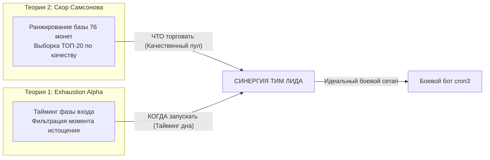

# ============================================================
# FILE: COIN_SELECTION_THEORIES.md
# ROLE: Quant research manifest & theoretical models for coin selection bridge (Radar -> Combat)
# ============================================================

# Квантовые Теории Селекции Монет: Мост «Фабрика Звёзд ➔ Боевой Бот»
**Автор концепции**: Главный Тим Лид Самсонов Николай  
**Роль документа**: Теоретический фундамент и математический регламент фильтрации активов между исследовательским полигоном (38 Вселенных на 76 монетах) и боевым ядром (`cron3`).  
**Статус**: **ЧИСТО ТЕОРЕТИЧЕСКИЕ ГИПОТЕЗЫ (Research Hypotheses & Quant Models)**

---

## 1. Архитектурная триада экосистемы

---

## 2. Теория 1: «Exhaustion Alpha» (Фазовый сдвиг и Истощение Продавцов)

### 2.1. Критика наивного вывода Штурмана
* **Ложный вывод**: *«Если боевой бот перемалывает в плюс даже двух главных аутсайдеров рынка (0G и GRASS), то заправив в него лидеров Фабрики Звёзд (JUP, PYTH, ZRO), доходность вырастет кратно!»*
* **Почему вывод ложный**: 
  - Не учитывается **фазовый сдвиг моментов запуска**. 
  - Лидеры полигона показали свои иксы, потому что полигон находился в них **во время развития их импульса**.
  - Запуск боевого бота на лидере *в текущий момент* означает вход на хаях, на излете импульса, в фазе расширенной волатильности, где риск поймать затяжную коррекцию и застрять на 5–9 колен максимален.

### 2.2. Физика феномена: почему 0G и GRASS дали рекордный профит в бою
1. **Поглощение боли полигоном**: Монеты 0G и GRASS в Фабрике Звёзд приняли на себя удар тяжелейшего краха (бумажный убыток -$80..-$100, зависание на 7-м колене).
2. **Истощение продавцов (Seller Exhaustion)**: К моменту старта боевого бота монеты вымыли маржинальные ликвидации, импульс падения затух, стакан стабилизировался в фазе донной аккумуляции/отскока.
3. **Эффект нулевого багажа (Zero Baggage Entry)**: Боевой бот стартовал с чистым депозитом, взял 1-е и 2-е колена на самом дне и забрал чистые быстрые тейки с идеальным Recovery Factor (>5.0).

> [!NOTE]
> **Суть Теории 1**: Когда по Фабрике Звёзд монеты сидят в максимальном минусе и затухает расширение просадки — это теоретически **лучший момент для их свежего запуска в боевом боте**.

---

## 3. Теория 2: «Квантовый Скор Самсонова» (Samsonov Metric)

Для отбора **ТОП-20 активов из 76 монет** полигона предлагается многофакторная формула, объединяющая устойчивость к риску, монетизацию волатильности и динамику оборота капитала.

### 3.1. Математическая формулировка

#### Вариант А (Полный скор с фактором частоты оборота):
$$\mathbf{Score}_{\mathbf{Samsonov}} = \left| \frac{\text{Peak Net}}{\text{Max DD}} \right| \times \text{Realized PnL}_{\text{net}} \times \text{Trade Velocity Ratio}$$

#### Вариант Б (Базовый скор без фактора частоты):
$$\mathbf{Score}_{\mathbf{Samsonov\_base}} = \left| \frac{\text{Peak Net}}{\text{Max DD}} \right| \times \text{Realized PnL}_{\text{net}}$$

---

### 3.2. Декомпозиция квантовых множителей

| Множитель | Квантовый смысл | За что награждает / Что штрафует |
| :--- | :--- | :--- |
| $\mathbf{\left\| \frac{\text{Peak Net}}{\text{Max DD}} \right\|}$ | **Индекс асимметрии риска (Historical Resilience)** | **Награждает**: монеты, дающие высокий пик прибыли при минимальной просадке (коэф. > 3.0..5.0). **Жестко штрафует**: «американские горки» и токсичные памп-дампы (например, пик +10$ при DD -100$ дает штрафной коэф. 0.1). |
| $\mathbf{\text{Realized PnL}_{\text{net}}}$ | **Денежная монетизация (Cash Generation)** | **Награждает**: монеты, реально наполнившие кассу чистым кэшем за вычетом всех комиссий биржи. **Отсекает**: статистические случайности (монета с 1 сделкой и нулевой просадкой не попадет в топ из-за микроскопического Realized). |
| $\mathbf{\text{Trade Velocity Ratio}}$ | **Коэффициент живости и оборачиваемости (Capital Turnover)** | **Награждает**: монеты с высокой частотой циклов прямо сейчас (сетка непрерывно дышит и нарезает прибыль). **Отсекает**: «уснувшие» монеты во флэте, где капитал заморожен без движения. |

---

## 4. Сравнительный анализ и синергия двух теорий

### Синергетический регламент:
1. **Штурман** рассчитывает **Скор Самсонова** по всем 76 монетам Фабрики Звёзд и отбирает пул **ТОП-20**.
2. Внутри этого ТОП-20 отслеживается **фаза монеты (Теория 1)**:
   - Если монета из ТОП-20 находится на локальном историческом пике (`Floating ≈ 0`, сильный безоткатный рост) — старт откладывается.
   - Если монета из ТОП-20 пережила локальный шторм в полигоне, набрала просадку, но скорость просадки остановилась — **активируется боевой запуск** с чистым депозитом.

---

## 5. План экспериментальной проверки (Backtest & Paper Verification)

1. [ ] Реализовать расчет обоих вариантов Скора Самсонова (с `Velocity` и без) в скрипте среза полигона.
2. [ ] Сформировать два независимых списка ТОП-20 по 76 монетам из `cron3PapperUniverses`.
3. [ ] Проверить совпадение лидеров и оценить их поведение при переносе в боевые купола.
4. [ ] Зафиксировать результаты в журнале ADR.
